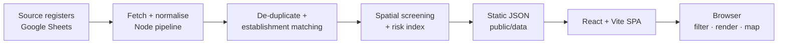

# ENVIS Dashboard — Environmental Permits Monitoring System

[](#)
[](#)
[](#)
[](#)

A static, browser-based analytics and geospatial platform for DENR-EMB Region VII that
intercrosses the region's environmental compliance registers — Discharge Permits (DP),
Permits to Operate (PTO), Hazardous Waste (HW) registrations, ECC/CNC clearances and a
full legal docket — into one searchable, map-driven view for Cebu and Bohol.

The browser loads pre-compiled JSON and only filters and renders: no server, no database,
no per-request queries. Data processing happens at build time through a reproducible Node
pipeline.

## Highlights

- **Establishment intercross** — DP, PTO, HW and clearance records merged by normalised
  name and LGU, with coverage-gap detection and alias/fuzzy matching guards.
- **Geospatial intelligence** — clustered Leaflet map, key-less basemaps, on-demand spatial
  overlays (flood, landslide, protected areas, watersheds, land cover/classification) with
  zoom-to-layer and a transparent additive risk index (0–10).
- **ECC / CNC Ultralist** — approved EIA clearances consolidated from the ECC OL,
  ECC Manual, CAT C and CNC OL tabs, limited to Cebu and Bohol and intercrossed with DP,
  PTO and hazardous-waste records.
- **Legal docket module** — NOV, PAB, ERF and complaint records matched to establishments
  by exact and reviewed names only; paid/pending and closed/open status per case; PAB
  coverage and yearly collections reported without exposing amounts on individual records.
- **Data quality first** — QA flags, audit trails, review queues, duplicate sources and
  skipped-row reporting; nothing is imputed silently.
- **Export-gated access** — login screen with role-based export permissions.

## Architecture



The legal layer follows the same pattern: a pinned snapshot is normalised by a vendored
module and emitted as `legal.json`, consumed by the same SPA.

## Tech stack

| Concern | Choice |
| --- | --- |
| App | Vite 6, React 19, TypeScript |
| Styling | Tailwind CSS 3, custom DENR dark/light theme |
| Charts | ECharts 5 via `echarts-for-react` |
| Map | Leaflet 1.9 + `leaflet.markercluster`, key-less Esri/OSM basemaps |
| State | Zustand |
| Data pipeline | Node ESM scripts + mapshaper |

## Quick start

```bash
npm install
npm run dev          # http://localhost:5173
npm run build        # type-check + production bundle in dist/
npm run preview      # serve the production bundle
```

No environment file and no secret to configure. The compiled dataset ships in `public/data/`,
so `npm run dev` works on a fresh clone.

## Data pipeline

```bash
npm run data:fetch     # source registers -> raw CSV
npm run data:spatial   # spatial sources -> GeoJSON
npm run data:build     # raw CSV -> compiled JSON
npm run data:ecc       # ECC / CNC ultralist -> ecc-ultralist.json
npm run data:legal     # legal snapshot -> legal.json
npm run data:all       # run all of the above in order
```

`npm run data:legal:check` rebuilds the legal dataset and fails if a record count no longer
reconciles with the vendored normaliser.

## Deployment

`npm run build` emits a fully static `dist/`. Because `vite.config.ts` sets `base: './'`, the
bundle can be hosted at a domain root or in a subfolder (GitHub Pages, S3, IIS, nginx). Serve
`dist/index.html` for `#/` hash routes; no rewrite rules are required.

## Security

- Login-gated exports restricted to authorised roles.
- Accounts are defined in `src/lib/auth.ts` and stored as SHA-256 password hashes. The MIS
  account can add, edit, deactivate and reset accounts from the in-app admin panel.
- CSV/JSON exports and GeoJSON downloads are gated behind role-based login.
- Error boundary renders a generic message — no stack traces reach end users.
- CSV export hardened against formula injection.
- No server-side surface: static files only.

### MIS admin panel

The `[redacted]` account has an **Accounts & Activity** page (sidebar → Administration):

- **Accounts** — add accounts, change usernames / display names / divisions / roles, reset
  passwords, activate / deactivate and delete accounts.
- **Activity** — sign-ins, failed sign-ins, sign-outs, CSV exports, GeoJSON downloads and
  account changes, with search, filters and a CSV export of the log.

Account and activity data is stored in the browser's `localStorage`, so it is specific to
the device and browser where it was recorded. A shared backend is required to sync users
and activity across devices.

## Limitations

- Register rows are not unique facilities; use establishment counts for site-level reporting.
- Some rows lack barangay, industry or expiry, and some coordinates are suspect. These are
  flagged, not corrected silently.
- Fuzzy matches and simplified screening polygons are decision support, not an official
  determination.

## License

Released under the MIS Credit License. See `LICENSE`. Permit data belongs to DENR-EMB Region VII.  
Basemaps provided by Esri and OpenStreetMap contributors.  
This dashboard is a monitoring aid and does not replace official records, permits or clearances.
No screenshots of the live application are included in this repository.
