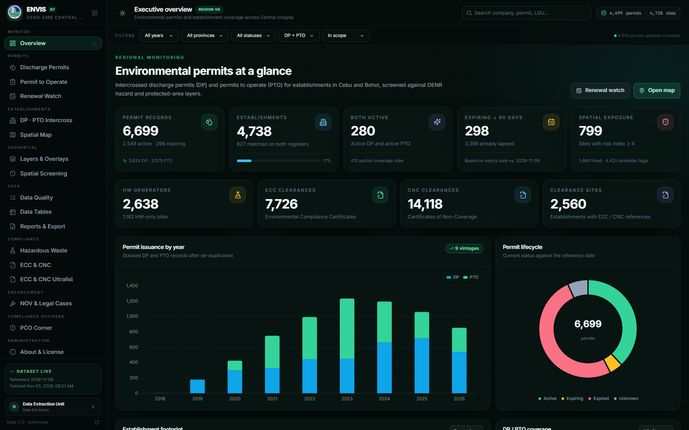
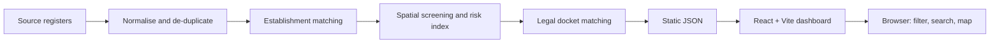
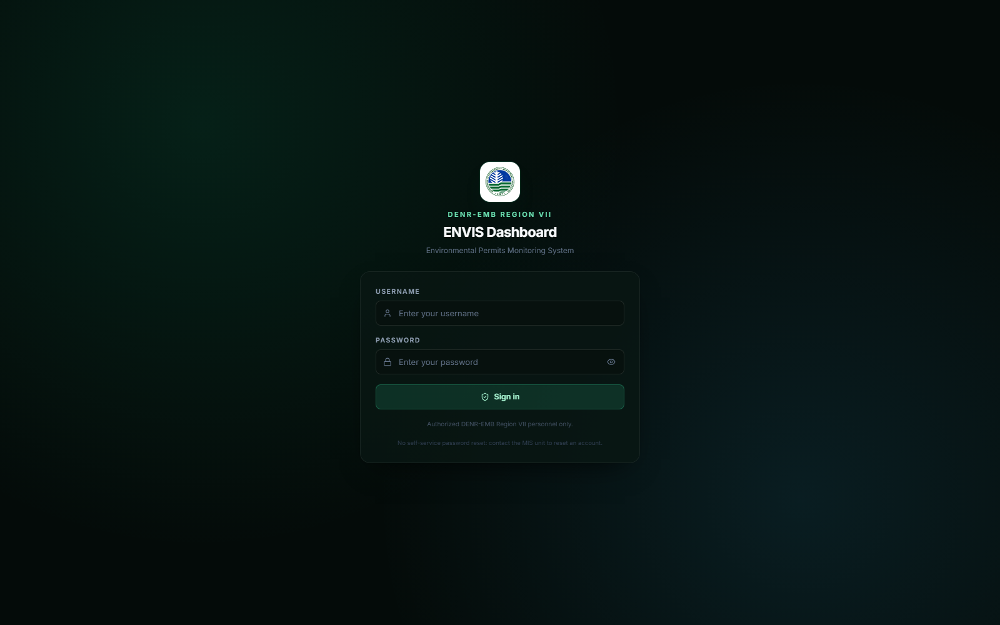
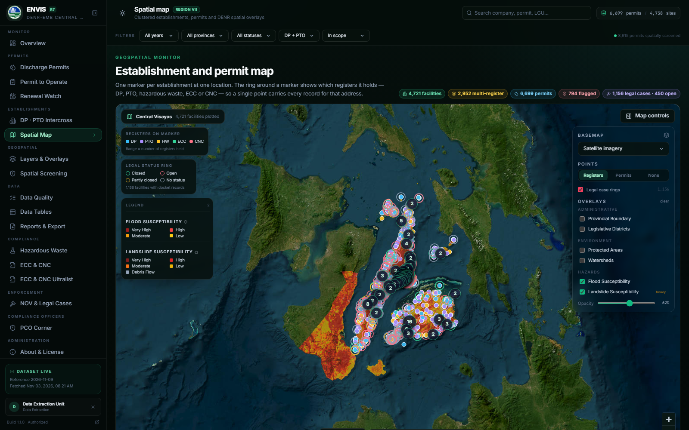
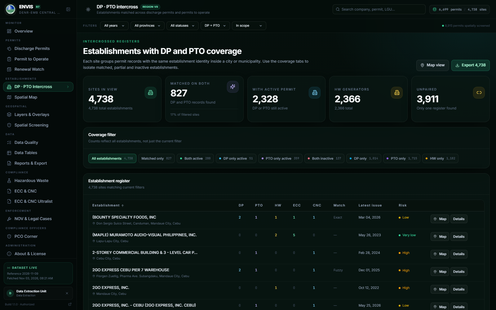
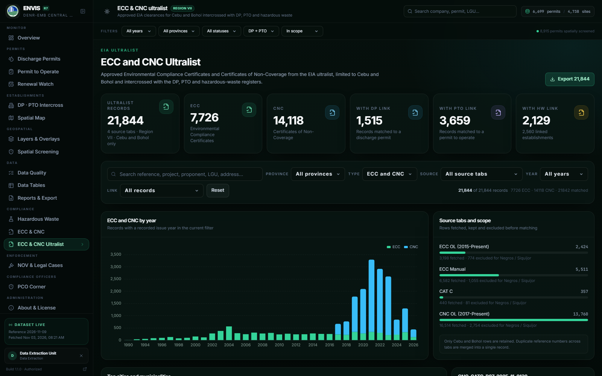
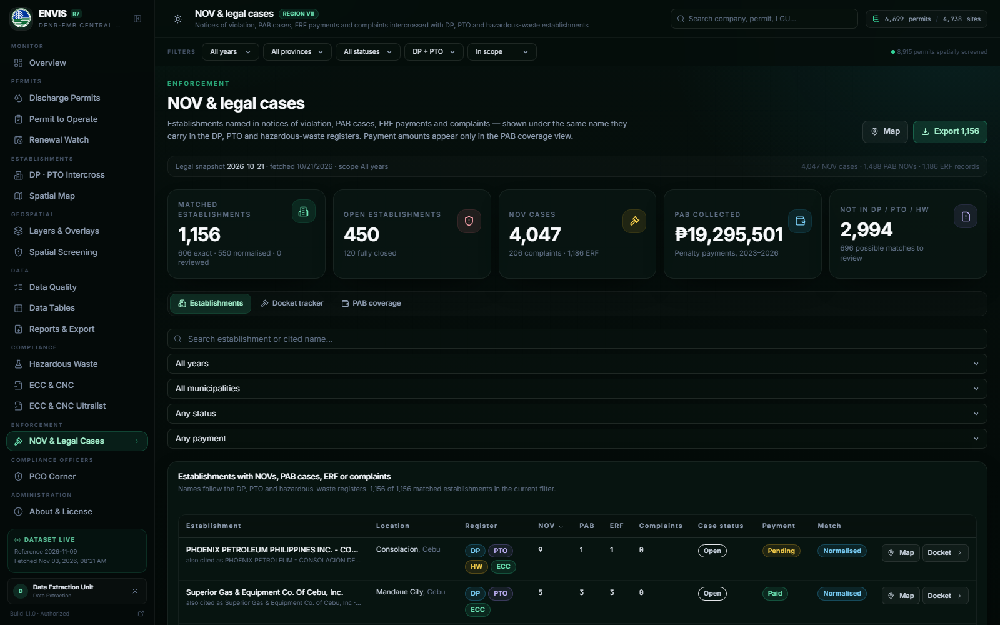
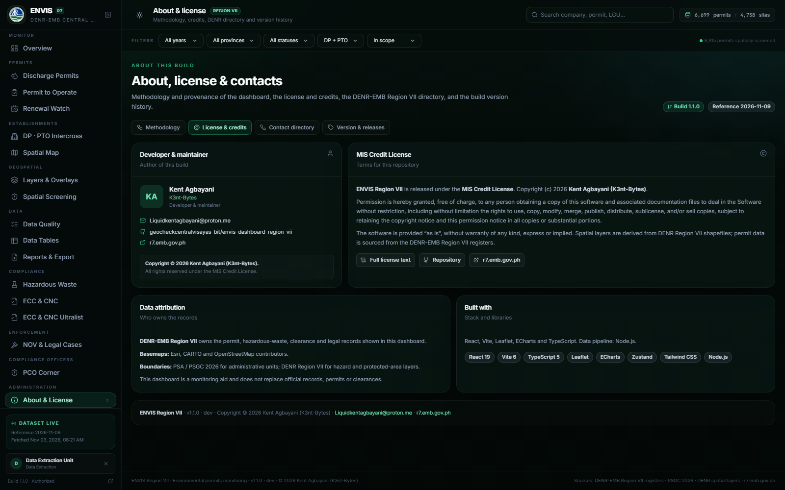
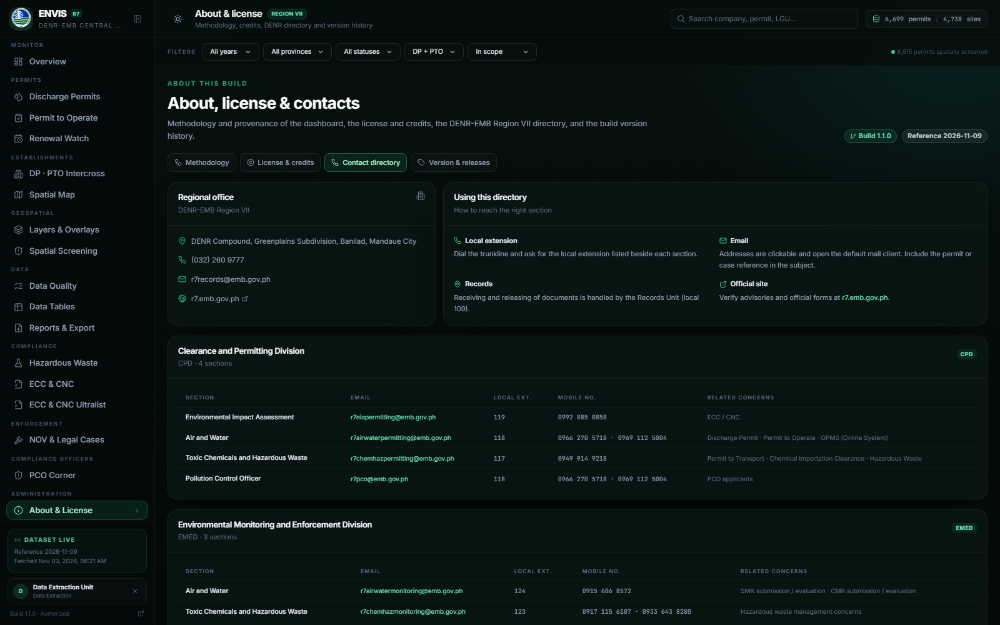

# ENVIS Dashboard — Environmental Permits Monitoring System

**ENVIS Region VII** is a browser-based environmental permits and compliance
intelligence platform for **DENR-EMB Region VII**. It brings the region's
discharge permits, permits to operate, hazardous-waste registrations, ECC/CNC
clearances and legal docket into one searchable, map-driven view for Cebu and
Bohol.

---

## What ENVIS is

Environmental regulation produces many separate registers. A single
establishment can appear in the discharge-permit register, the permit-to-operate
register, the hazardous-waste register, the ECC/CNC clearance list and the legal
docket — often under slightly different names and addresses. Reading those
registers one at a time makes it hard to answer basic questions:

- Does this establishment hold both a discharge permit and a permit to operate?
- Which facilities are operating with only one of the two?
- Which permits are expiring, and which have already lapsed?
- Which establishments sit inside flood, landslide, protected-area or watershed
  constraints?
- Which facilities have environmental cases, and what is the status of each case?

ENVIS answers those questions in one place. It is a monitoring and decision-support
aid, not a replacement for official records, permits or clearances.

## Why it matters

- **One establishment, one view.** Registers are intercrossed so a facility is
  assessed as a whole rather than as disconnected rows in different sheets.
- **Coverage gaps become visible.** DP-only and PTO-only establishments are
  surfaced instead of being hidden by separate reports.
- **Enforcement is better targeted.** Spatial screening and the legal docket show
  where environmental risk and case history coincide.
- **Field and front-desk work is faster.** Search, filters and a clustered map
  replace manual cross-referencing across year tabs.
- **The evidence trail is preserved.** Data-quality flags, review queues and
  source counts make it clear what was matched, what was skipped and what still
  needs review.

## What it covers

| Register | Scope |
| --- | --- |
| Discharge Permits (DP) | 2019–2026 year tabs, Cebu and Bohol |
| Permits to Operate (PTO) | 2020–2026 year tabs, Cebu and Bohol |
| Hazardous waste | Generator registrations intercrossed with DP and PTO |
| ECC / CNC | Environmental Compliance Certificates and Certificates of Non-Coverage |
| ECC / CNC Ultralist | ECC OL, ECC Manual, CAT C and CNC OL records for Cebu and Bohol |
| Legal docket | NOV, PAB, ERF and complaint records |
| PCO Corner | Pollution Control Officer registry and analysis |
| Spatial layers | Flood, landslide, protected areas, watersheds, land cover, land classification, boundaries |

## How it works

ENVIS is a static site. All heavy work happens before publication, so the browser
only filters and renders pre-compiled JSON — no database, no server and no
per-request queries.

1. **Normalise.** Permit rows are mapped to a shared schema; names, dates,
   provinces, LGUs, barangays and coordinates are cleaned and every change is
   logged.
2. **De-duplicate.** Permit numbers are reconciled so the same permit from
   multiple sources becomes one record.
3. **Build establishments.** Records are grouped by LGU and normalised company
   name, with alias and guarded fuzzy matching. A match is rejected when branch
   markers, parenthetical names or coordinates conflict.
4. **Screen spatially.** Establishments are tested against simplified hazard and
   protected-area layers, and a transparent additive risk index is derived.
5. **Match the legal docket.** NOV, PAB, ERF and complaint respondents are linked
   to establishments by exact or reviewed names only — never by automatic fuzzy
   matching.
6. **Publish and explore.** The browser loads compact JSON and provides search,
   filters, tables, charts and a clustered Leaflet map.

## Highlights

- **Establishment intercross** — DP, PTO, hazardous-waste and clearance records
  merged by normalised name and LGU, with coverage-gap detection and alias/fuzzy
  matching guards.
- **Geospatial intelligence** — clustered map, key-less basemaps, on-demand
  overlays (flood, landslide, protected areas, watersheds, land cover and land
  classification), zoom-to-layer and a transparent additive risk index (0–10).
- **ECC / CNC Ultralist** — approved EIA clearances consolidated from the ECC OL,
  ECC Manual, CAT C and CNC OL tabs, limited to Cebu and Bohol and intercrossed
  with DP, PTO and hazardous-waste records.
- **Legal docket module** — NOV, PAB, ERF and complaint records matched to
  establishments by exact and reviewed names only; paid/pending and closed/open
  status per case; PAB coverage and yearly collections reported without exposing
  amounts on individual records.
- **Renewal watch** — permits approaching expiry and already-lapsed permits are
  grouped so follow-up work can be prioritised.
- **Data quality first** — QA flags, audit trails, review queues, duplicate
  sources and skipped-row reporting; nothing is imputed silently.
- **Role-based access** — a login gate with role-specific visibility and export
  permissions; the Regional Director has full visibility but no export controls,
  and the Regional Director session does not expire.
- **MIS administration** — the MIS account manages accounts, resets passwords,
  activates or deactivates users and reviews sign-in, export and account-change
  activity from the in-app Accounts & Activity page.
- **Light and dark themes** — a DENR-themed interface that stays readable in
  bright field conditions.
- **Static and portable** — the production bundle can be hosted at a domain root
  or in a subfolder (GitHub Pages, S3, IIS, nginx) with no server-side component.

## Screenshots

### Sign in

### Spatial map

One marker per establishment; rings show which registers the facility holds.

### DP · PTO intercross

### ECC / CNC Ultralist

### Legal docket

### About & License

Author, license, the full DENR-EMB Region VII contact directory and build
version history live in the **About & License** page.

## Roles and access

| Role | Visibility | Export |
| --- | --- | --- |
| Data extraction | Full dashboard | CSV / JSON |
| Regional Director | Full dashboard, including reports | None |
| EMED | Monitoring and enforcement views | None |
| CPD | Clearance and permitting views | None |
| MIS | Full dashboard and administration | CSV / JSON |
| GIS | Spatial and map views | GeoJSON |
| Viewer | Read-only dashboard | None |

Accounts and activity are stored in the browser's local storage, so they are
specific to the device where they were recorded. A shared backend is required to
synchronise users and activity across devices.

## Data quality and limitations

- Register rows are not unique facilities; use establishment counts for site-level
  reporting.
- Some rows lack barangay, industry or expiry, and some coordinates are suspect.
  These are flagged, not corrected silently.
- Fuzzy establishment matches and simplified screening polygons are decision
  support, not an official determination.
- Legal status is only as complete as the source registers; cases with no closing
  or pending signal are shown as *no status*, not assumed resolved.
- PAB collections are yearly totals only; no payment amount is attributed to an
  individual establishment or case.
- The dashboard is a monitoring aid and does not replace official records,
  permits or clearances.

## Versioning and releases

Every push to `main` triggers the deploy workflow in GitHub Actions. The build
embeds the `package.json` version, the Actions build number and the short commit
SHA. After a successful deployment the workflow creates a GitHub release tagged
`v<version>-b<build>`, so every change has a traceable version.

The deployed identity is shown in the sidebar footer, the page footer and the
**About & License → Version & releases** tab, with direct links to the GitHub
Actions runs and releases.

## Security

- Login names and passwords are **not** stored in plaintext in the repository or
  the published bundle. Built-in accounts are seeded with opaque keys and salted
  PBKDF2-SHA256 password hashes.
- Source maps are disabled in production, so the shipped bundle does not expose
  application source files.
- CSV/JSON exports and GeoJSON downloads are gated behind role-based login.
- CSV export is hardened against formula injection.
- The error boundary renders a generic message; no stack traces reach end users.
- No server-side surface: static files only.

## About the author

**Kent Agbayani (K3nt-Bytes)** — developer and maintainer  
Email: [Liquidkentagbayani@proton.me](mailto:Liquidkentagbayani@proton.me)  
Repository: [geocheckcentralvisayas-bit/envis-dashboard-region-vii](https://github.com/geocheckcentralvisayas-bit/envis-dashboard-region-vii)

## License

Released under the **MIS Credit License**. See [LICENSE](LICENSE).

Copyright © 2026 **Kent Agbayani (K3nt-Bytes)**.

Permit data belongs to DENR-EMB Region VII. Basemaps are provided by Esri, CARTO
and OpenStreetMap contributors. Boundaries follow PSA / PSGC 2026 for
administrative units and DENR Region VII for hazard and protected-area layers.

## Contact

**DENR-EMB Region VII**  
DENR Compound, Greenplains Subdivision, Banilad, Mandaue City  
Trunkline: (032) 260 9777  
Email: r7records@emb.gov.ph  
Website: [r7.emb.gov.ph](https://r7.emb.gov.ph/)

The complete division directory — section emails, local extensions, mobile
numbers and related concerns — is available in the dashboard under
**About & License → Contact directory**.
